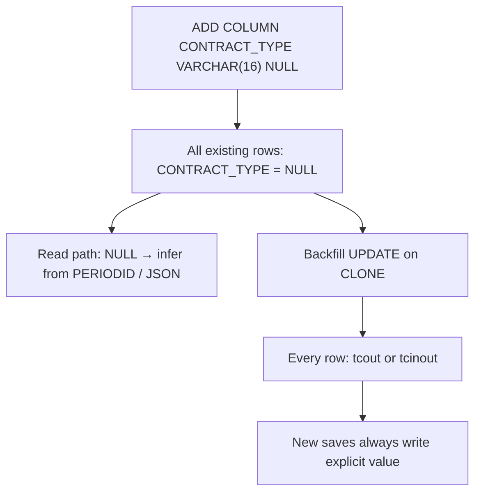
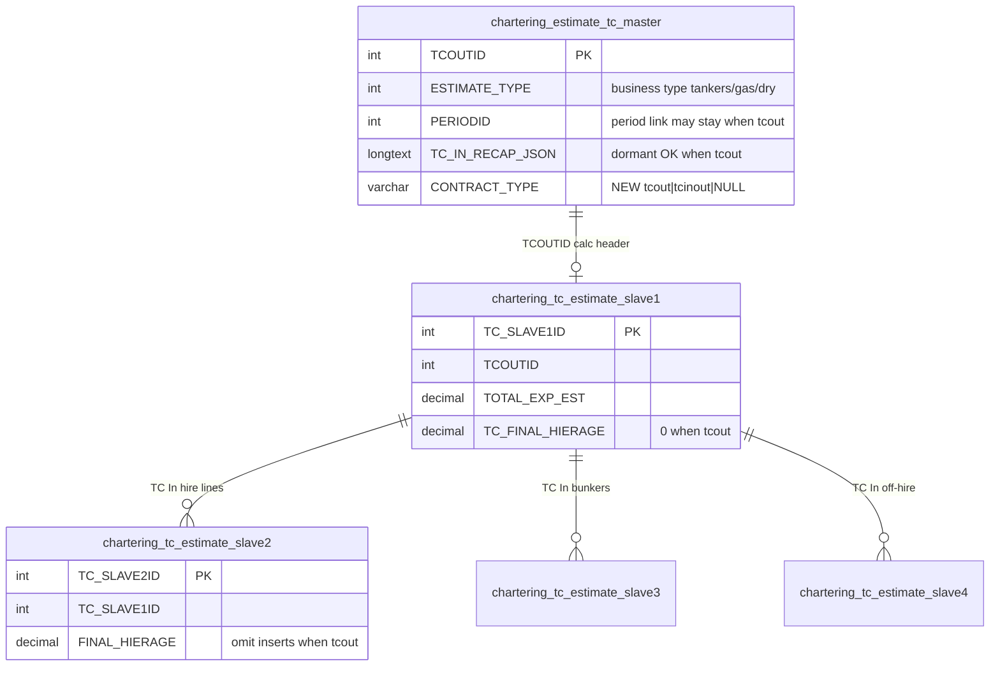

# TC Recap CONTRACT_TYPE Column Implementation Plan

> **For agentic workers:** REQUIRED SUB-SKILL: Use superpowers:subagent-driven-development (recommended) or superpowers:executing-plans to implement this plan task-by-task. Steps use checkbox (`- [ ]`) syntax for tracking.

**Goal:** Persist Contract Type (`tcout` | `tcinout`) in a new master column so Hire Recap JSON can stay dormant under TC Out and restore P&L when switched back, without clearing `TC_IN_RECAP_JSON`.

**Architecture:** Add `CONTRACT_TYPE VARCHAR(16) NULL` on `chartering_estimate_tc_master` (ensure-column boot guard + clone-first backfill). Writes always set the column. Reads prefer the column; `NULL` falls back to period/JSON inference until backfilled. Active P&L / slave2–4 follow mode; JSON is retained when mode is `tcout`.

**Tech Stack:** MySQL/MariaDB, Express (`tcEstimateDb.js`, `tcEstimateMappers.js`), React TC Recap (`TcFixtureFormPage.jsx`, `tcRecapValidation.js`).

**Spec:** [docs/superpowers/specs/2026-11-24-tc-contract-type-column-design.md](../specs/2026-11-24-tc-contract-type-column-design.md)

## Global Constraints

- Applies to **all** TC Recaps — Tankers, Gas, and Dry (`ESTIMATE_TYPE` / business type is orthogonal; do not scope this column to tankers only).
- DDL + backfill must be verified on a **cloned** database first; never run destructive migration against production until clone matrix passes.
- Values stored: `'tcout'` | `'tcinout'` only (normalize on write).
- List badge must prefer `CONTRACT_TYPE` so TC Out + dormant JSON shows **TC Out**.
- Keep `PERIODID` linked when switching to TC Out (dormant alongside JSON); mode column is authoritative.
- Do not clear `TC_IN_RECAP_JSON` when saving as TC Out.
- When mode is `tcout`, slave1 TC In hireage must be 0 and do not insert active slave2/3/4 hire rows even if JSON is passed for dormancy.

---

## Schema context (what changes / what does not)

### Scope: not tanker-only

| Concept | Column / field | Meaning |
|---------|----------------|---------|
| Business type | `ESTIMATE_TYPE` | Tankers / Gas / Dry filter (e.g. `2` = Tankers, `3` = Dry in UI) |
| Contract mode | **`CONTRACT_TYPE` (new)** | Form dropdown: TC Out vs TC In/TC Out — **same for every business type** |

### After migration — master row shape (key columns)

```text
chartering_estimate_tc_master
├─ TCOUTID (PK)
├─ ESTIMATE_TYPE          -- business type (tankers/gas/dry) — UNCHANGED
├─ PERIODID               -- period contract link — KEEP when TC Out
├─ TC_IN_RECAP_JSON       -- Hire Recap blob — KEEP when TC Out (dormant)
├─ CONTRACT_TYPE  ★ NEW   -- 'tcout' | 'tcinout' | NULL (pre-backfill only)
├─ … (vessel, hire, CP, bunkers, PICs, attachments, etc.)
```

### NULL handling (migration)



| Phase | DB value | App behavior |
|-------|----------|--------------|
| Immediately after DDL | `NULL` on every old row | Safe: list/detail fall back to current inference |
| After backfill | non-NULL | Explicit mode; dormant JSON no longer forces badge |
| Ongoing writes | always set | Never persist NULL from the form |

**Backfill rule (clone first):**

```sql
UPDATE chartering_estimate_tc_master
SET CONTRACT_TYPE = CASE
  WHEN (PERIODID IS NOT NULL AND TRIM(CAST(PERIODID AS CHAR)) NOT IN ('', '0'))
    OR (TC_IN_RECAP_JSON IS NOT NULL AND TRIM(TC_IN_RECAP_JSON) NOT IN ('', 'null', '{}'))
  THEN 'tcinout'
  ELSE 'tcout'
END
WHERE CONTRACT_TYPE IS NULL;
```

### ER — master + calc children (relevant to this feature)



Other related tables exist (`chartering_estimate_tc_slave*`, hire invoices, etc.) but **are not altered** by this plan. Only master gains a column; slave1/2/3/4 write behavior is gated by mode.

### Example rows after backfill (illustrative)

| TCOUTID | ESTIMATE_TYPE | PERIODID | TC_IN_RECAP_JSON | CONTRACT_TYPE | List badge |
|---------|---------------|----------|------------------|---------------|------------|
| 1 | 2 (Tankers) | NULL/0 | empty | `tcout` | TC Out |
| 2 | 2 (Tankers) | NULL | has JSON | `tcinout` | TC In/TC Out |
| later | 3 (Dry) | 55 | has JSON | user sets `tcout` | **TC Out** (JSON kept) |

---

## File map

| File | Responsibility |
|------|----------------|
| `backend/src/services/tcEstimateDb.js` | `ensureTcContractTypeColumn`, map `CONTRACT_TYPE` on create/update/list/calc; stop nulling JSON on TC Out; gate slave1 hireage / slave2–4 |
| `backend/src/services/tcEstimateMappers.js` | `normalizeContractType`, detail + list pass column into `tcContractTypeLabel` |
| `backend/src/services/tcEstimateMappers.test.js` | Column priority + NULL fallback + periodId 0 |
| `backend/src/services/opsTcDb.js` | If list uses same label helper, select/pass `CONTRACT_TYPE` when present |
| `frontend/pages/internal-user/tc/TcFixtureFormPage.jsx` | Prefer `detail.contractType`; stop clearing JSON; showSubCharter from contractType; zero active TC In scalars when tcout |
| `frontend/pages/internal-user/tc/tcRecapValidation.js` | `isSubCharterForm` uses contractType (not periodId OR) |
| `frontend/pages/internal-user/tc/tcRecapValidation.test.js` | periodId 0 + contractType cases |
| `docs/superpowers/specs/2026-11-24-tc-contract-type-column-design.md` | Spec (already written) |

---

### Task 1: Clone-DB safety gate + DDL + backfill script

**Files:**
- Create: `docs/sql/2026-11-24-tc-contract-type-column-clone.sql` (or repo’s existing SQL docs folder if preferred)
- Modify: none yet (script-only task)

**Interfaces:**
- Consumes: clone datasource (not production `zafira`)
- Produces: verified `CONTRACT_TYPE` column + backfilled values on clone

- [ ] **Step 1: Confirm clone identity**

Run on the intended clone connection only:

```sql
SELECT DATABASE(), @@hostname, @@port;
```

Expected: database name is the **clone**, not production. Abort if wrong.

- [ ] **Step 2: Baseline snapshot**

```sql
SELECT
  COUNT(*) AS total,
  SUM(CASE
    WHEN (PERIODID IS NOT NULL AND TRIM(CAST(PERIODID AS CHAR)) NOT IN ('', '0'))
      OR (TC_IN_RECAP_JSON IS NOT NULL AND TRIM(TC_IN_RECAP_JSON) NOT IN ('', 'null', '{}'))
    THEN 1 ELSE 0 END) AS expected_tcinout
FROM chartering_estimate_tc_master;
```

Record `total` and `expected_tcinout`.

- [ ] **Step 3: Add column on clone**

```sql
ALTER TABLE chartering_estimate_tc_master
  ADD COLUMN CONTRACT_TYPE VARCHAR(16) NULL;
```

- [ ] **Step 4: Verify all NULLs pre-backfill**

```sql
SELECT COUNT(*) AS nulls
FROM chartering_estimate_tc_master
WHERE CONTRACT_TYPE IS NULL;
```

Expected: `nulls = total` from Step 2.

- [ ] **Step 5: Backfill**

Run the backfill `UPDATE` from Schema context above.

- [ ] **Step 6: Verify backfill counts**

```sql
SELECT CONTRACT_TYPE, COUNT(*) AS n
FROM chartering_estimate_tc_master
GROUP BY CONTRACT_TYPE;

SELECT COUNT(*) AS still_null
FROM chartering_estimate_tc_master
WHERE CONTRACT_TYPE IS NULL;
```

Expected: `still_null = 0`; `tcinout` count ≈ `expected_tcinout`.

- [ ] **Step 7: Commit SQL script only**

```bash
git add docs/sql/2026-11-24-tc-contract-type-column-clone.sql
git commit -m "docs(sql): clone DDL+backfill for TC CONTRACT_TYPE column"
```

---

### Task 2: Backend ensure-column + normalize + masterPayload wiring

**Files:**
- Modify: `backend/src/services/tcEstimateDb.js` (mirror `ensureTcInRecapJsonColumn` ~L66–84; `masterPayload` ~L157–271; create/update payload blocks)
- Modify: `backend/src/services/tcEstimateMappers.js` (`normalizeContractType`, `mapTcDetail`, `mapTcListRow` / `tcContractTypeLabel` call sites)
- Test: `backend/src/services/tcEstimateMappers.test.js`

**Interfaces:**
- Consumes: `body.contractType` from API (`'tcout'|'tcinout'|''`)
- Produces: `normalizeContractType(value) -> 'tcout'|'tcinout'|''`; detail.contractType; list label prefers column

- [ ] **Step 1: Write failing mapper tests**

Add cases:

1. `tcContractTypeLabel({ contractType: 'tcout', hasTcInRecap: true })` → `'TC Out'`
2. `tcContractTypeLabel({ contractType: '', hasTcInRecap: true })` → `'TC In/TC Out'` (NULL/legacy fallback)
3. `mapTcDetail` with `CONTRACT_TYPE: 'tcout'` exposes `contractType: 'tcout'`
4. `periodId: '0'` still normalizes to empty / not sub-charter via existing helpers

- [ ] **Step 2: Run tests — expect fail**

Run: `npm test --prefix backend -- --testPathPattern=tcEstimateMappers`  
(or project’s equivalent)

- [ ] **Step 3: Implement `normalizeContractType` + list/detail mapping**

```js
export function normalizeContractType(value) {
  const code = String(value || '').trim().toLowerCase();
  if (code === 'tcinout' || code === 'tc in/tc out') return 'tcinout';
  if (code === 'tcout' || code === 'tc out') return 'tcout';
  return '';
}
```

Wire `mapTcListRow` to pass `contractType: row.CONTRACT_TYPE` into `tcContractTypeLabel`.  
Wire `mapTcDetail` to `contractType: normalizeContractType(row.CONTRACT_TYPE)`.

- [ ] **Step 4: Implement `ensureTcContractTypeColumn` + masterPayload**

Same pattern as `ensureTcInRecapJsonColumn`. Include `CONTRACT_TYPE` in create/update payloads when column exists.

- [ ] **Step 5: Re-run mapper tests — expect pass**

- [ ] **Step 6: Commit**

```bash
git add backend/src/services/tcEstimateDb.js backend/src/services/tcEstimateMappers.js backend/src/services/tcEstimateMappers.test.js
git commit -m "feat(tc): add CONTRACT_TYPE column wiring and mapper priority"
```

---

### Task 3: Stop clearing JSON; gate calc/P&L on mode

**Files:**
- Modify: `backend/src/services/tcEstimateDb.js` (`dbSaveTcCalculation` ~L1452–1586; create/update JSON write guards)
- Modify: `frontend/pages/internal-user/tc/TcFixtureFormPage.jsx` (save payload ~L1890–1962)

**Interfaces:**
- Consumes: `body.contractType`, optional `body.tcInExpenses`
- Produces: JSON retained on tcout; `TC_FINAL_HIERAGE` / totalExp exclude TC In when tcout; no slave2/3/4 inserts when tcout

- [ ] **Step 1: Change frontend save**

- Always send `contractType: form.contractType || 'tcout'`.
- When `showSubCharter`: send `tcInExpenses: form.tcInExpenses`.
- When `!showSubCharter`: **omit** `tcInExpenses` or send only if you intentionally update dormant blob — default **omit** so backend does not NULL the column. Prefer: if `hasSavedTcInHires(form.tcInExpenses)`, still send the object to re-persist dormancy without activating P&L; never send `null`.
- When `!showSubCharter`, force calc scalars: `tcFinalHireage: '0'` and clear TC In slave1 fields to `''`.

- [ ] **Step 2: Change backend JSON guards**

Only write `TC_IN_RECAP_JSON` when `body.tcInExpenses != null` (do **not** treat explicit null as clear for this feature).  
If `normalizeContractType(body.contractType) !== 'tcinout'`: force hireage 0 in slave1 math; skip replace of slave2/3/4 hire children (or write empty).

- [ ] **Step 3: Manual smoke against clone API** (optional curl) — skip if no running clone stack; covered in Task 5.

- [ ] **Step 4: Commit**

```bash
git add backend/src/services/tcEstimateDb.js frontend/pages/internal-user/tc/TcFixtureFormPage.jsx
git commit -m "feat(tc): keep dormant TC In JSON; gate active P and L by CONTRACT_TYPE"
```

---

### Task 4: Frontend load + showSubCharter + validation

**Files:**
- Modify: `frontend/pages/internal-user/tc/TcFixtureFormPage.jsx` (`applyTcDetailToForm`, `showSubCharter`)
- Modify: `frontend/pages/internal-user/tc/tcRecapValidation.js`
- Test: `frontend/pages/internal-user/tc/tcRecapValidation.test.js`

**Interfaces:**
- Consumes: `detail.contractType` from API
- Produces: form mode from column first; `showSubCharter === (contractType === 'tcinout' || sub-charter business type)` — **remove periodId OR** for mode (period picker still sets `contractType` to `tcinout` on change)

- [ ] **Step 1: Failing validation tests**

- `contractType: 'tcout'` + `periodId: '12'` → not treated as requiring TC In fields via `isSubCharterForm` (or document if business-type exception remains).
- `contractType: 'tcinout'` → sub-charter validation applies.

- [ ] **Step 2: Implement validation + form load order**

```js
const contractType = detail.contractType
  || ((periodId || hasSavedTcInHires(detail.tcInExpenses)) ? 'tcinout' : 'tcout');
```

`showSubCharter`:

```js
form.contractType === 'tcinout'
  || isSubCharterBusinessType(businessTypes, form.businessTypeId);
```

Keep `handlePeriodChange` setting `contractType: 'tcinout'` when user picks a period.

- [ ] **Step 3: Run frontend validation tests**

- [ ] **Step 4: Commit**

```bash
git add frontend/pages/internal-user/tc/TcFixtureFormPage.jsx frontend/pages/internal-user/tc/tcRecapValidation.js frontend/pages/internal-user/tc/tcRecapValidation.test.js
git commit -m "feat(tc): load CONTRACT_TYPE first; gate sub-charter UI on mode"
```

---

### Task 5: Clone functional matrix + ops list parity

**Files:**
- Modify if needed: `backend/src/services/opsTcDb.js` (select/pass `CONTRACT_TYPE` into `tcContractTypeLabel`)
- Test: manual on clone UI / API

**Interfaces:**
- Consumes: clone DB with column + backfill + running app pointed at clone
- Produces: signed-off matrix

- [ ] **Step 1: Point app at clone** (env / datasource) and boot; confirm `ensureTcContractTypeColumn` is idempotent.

- [ ] **Step 2: Case Pure TC Out**

Create/save TC Out → DB `CONTRACT_TYPE='tcout'`, JSON null/empty, badge TC Out.

- [ ] **Step 3: Case Dormant JSON**

Start TC In/TC Out with hire data → switch to TC Out → save → JSON **unchanged**, `CONTRACT_TYPE='tcout'`, badge TC Out, reopen form TC Out, P&L hire expense 0.

- [ ] **Step 4: Case Restore**

Same row → switch dropdown to TC In/TC Out → P&L hire restores from retained JSON without re-entry → save → badge TC In/TC Out.

- [ ] **Step 5: Repeat one Dry (`ESTIMATE_TYPE=3`) smoke** if sample data exists — proves not tanker-only.

- [ ] **Step 6: Commit any opsTcDb parity fix**

```bash
git add backend/src/services/opsTcDb.js
git commit -m "fix(tc): pass CONTRACT_TYPE into ops TC list labels"
```

---

### Task 6: Production rollout note (no execute in this task)

**Files:**
- Create: short note in plan appendix or `docs/sql/...-prod-rollout.md`

- [ ] **Step 1: Document prod sequence**

1. Backup  
2. `ADD COLUMN` (nullable)  
3. Deploy app with ensure-column + read fallback  
4. Run backfill  
5. Verify counts  

- [ ] **Step 2: Commit docs only — do not run on prod from this plan**

---

## Done when

- Clone DDL + backfill verified; zero remaining NULL after backfill.
- Saving TC Out keeps JSON; list shows TC Out; P&L excludes TC In hire.
- Switching back to TC In/TC Out restores P&L from JSON.
- Works for Tankers and at least one non-tanker business type smoke.
- Unit tests for mapper priority and validation pass.

---

## Appendix A — Full `chartering_estimate_tc_master` columns (zafira snapshot 2026-11-24)

Live local DB has **163 columns**. Only **`CONTRACT_TYPE`** is added. Existing key mode-related columns already present: `ESTIMATE_TYPE`, `PERIODID`, `TC_IN_RECAP_JSON`.

```text
TCOUTID (PK)
MODULEID, MCOMPANYID, FIXTURE_TYPE, VESSEL_IMO_ID, VESSEL_TYPE, FLAG
TC_DATE, TC_NO, CP_DATE1, SEL_CP_TYPE, SEL_CHARTERER, SEL_CHAR_OPER, LAW_ARBITRA, CHAR_OPER_ADD
BUILD_YARD, BUILT_YEAR1, FLAG_1, PORT_OF_REG, IMO_NO, CLASS_ID, LAST_SP_SURVEY, LAST_DD
OWNERS_PI, MASTERS_NAME, CALL_SIGN, INMARSAT_TEL, INMARSAT_MAIL
LOA1, BREADTH, SUMMER_DWT, SUMMER_DRAFT, TPC1, GROSS_TONN, NET_TONN
CARGO_TANK_CAP, NO_OF_GRADES, CARGO_PUMP_CAP, TOTAL_SBT_CAP, SUEZ_GRT, SUEZ_NRT, PANAMA_NRT
GRAIN_CAP1, BALE_CAP1, CRANES, GRABS, KEEL_TOP_MAST, WTR_TOP_MAST_FB
DEL_RANGE_PORT, DUR_FIX_PER, TRIP_TC, PERIOD, NO_OF_TRIP, DEL_DATE, RE_DEL_DATE
DUR_OPT_PER, COMM_OPT_PER, LAYCAN_FROM, LAYCAN_TO, LAYCAN_NARR, RE_DEL_RANGE
HIRE_FIX_PER, HIRE_OPT_PER
DEL_HFO, DEL_MGO, RE_DEL_HFO, RE_DEL_MGO, PRICE_DEL_HFO, PRICE_DEL_MGO, PR_REDEL_HFO, PR_REDEL_MGO
FUEL_SPECS, CVE_MONTH, TANK_CLEAN_EXP, ADD_EXP_LINE_ITEM, SUP_CARGO_MEAL, HOLD_CLEAN_INTER
ILOHC_USD, ILOHC_REMARKS, BRO_COMM_PAYABLE, ADD_COMM, BROKER_COMM, OWNERS_BANK_DET
DOC_CREAT_BY, ADDIT_INFORM, COMID, UPDATE_ON_DATE
… CP speed/consumption block (DWT_*_CP … LODE_RATE_TCCP / DISH_RATE_TCCP) …
FINAL_DATETIME, FINAL_STATUS, FIXED
ESTIMATE_TYPE          -- business type (2=Tankers, 3=Dry, …) — ORTHOGONAL to CONTRACT_TYPE
SHEET_NO, TOTAL_DAYS, TOTAL_EARNING
EXCHANGE_CURRENCY, EXCHANGE_RATE
BALTIC_ROUTE, BALTIC_DATE, BALTIC_RATE
PERIODID               -- period contract FK; may remain set when CONTRACT_TYPE=tcout
OWNER, CARGO_QTY, CARGO
CHARTERING_PIC, CHARTERING_PIC_1, CHARTERING_PIC_2
F_YEAR, ADDED_BY
TC_IN_RECAP_JSON       -- Hire Recap LONGTEXT; KEEP when tcout (dormant)
ESTIMATE_NO, ATTACHMENT, ATTACHMENT_NAME
CONTRACT_TYPE ★ NEW    -- VARCHAR(16) NULL → backfill to 'tcout'|'tcinout'
```

Local sample data today: only `ESTIMATE_TYPE = 2` (2 rows). Feature still applies to every type when Dry/Gas rows exist.

## Appendix B — Related calc tables (unchanged DDL; write behavior gated)

| Table | PK | FK | Role when `CONTRACT_TYPE=tcout` |
|-------|----|----|----------------------------------|
| `chartering_tc_estimate_slave1` | `TC_SLAVE1ID` | `TCOUTID` | Keep row; `TC_FINAL_HIERAGE` / TC In totals forced **0** |
| `chartering_tc_estimate_slave2` | `TC_SLAVE2ID` | `TC_SLAVE1ID` | No active hire-line inserts |
| `chartering_tc_estimate_slave3` | `TC_SLAVE3ID` | `TC_SLAVE1ID` | No active bunker inserts from Hire Recap |
| `chartering_tc_estimate_slave4` | `TC_SLAVE4ID` | `TC_SLAVE1ID` | No active off-hire inserts from Hire Recap |

`chartering_estimate_tc_slave1`…`slave10` are the TC **Out** estimate children — not part of this CONTRACT_TYPE change.

Clone SQL script: [docs/sql/2026-11-24-tc-contract-type-column-clone.sql](../../sql/2026-11-24-tc-contract-type-column-clone.sql)
